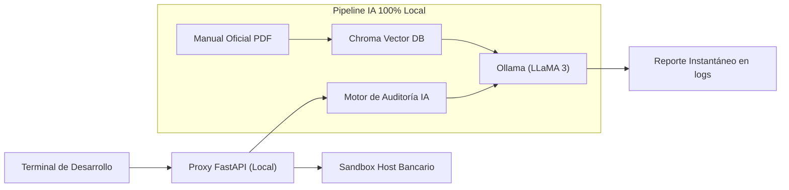

# Post 5: IA Local y RAG para Auditoría Automatizada de Payloads Financieros

**Autor:** Alejandro Barragán Jasso  
**Enfoque:** Tech Lead / Mobile & Embedded Payment Systems Engineer

---

## 📱 Copia para Publicación en LinkedIn

```text
🤖 Usando IA local (LLaMA 3 + LangChain) para auditar mensajes financieros sin enviar un solo dato a la nube

En el desarrollo de software para medios de pago, validar que cada trama (tags EMV TLV, identificadores, códigos de operación) cumpla al 100% con los extensos manuales técnicos suele ser un proceso manual lento y propenso a errores humanos.

Enviar estas trazas a APIs públicas de IA en la nube es inaceptable por regulaciones bancarias y privacidad de datos.

¿La solución? Diseñar un proxy interceptor local potenciado por RAG (Retrieval-Augmented Generation) y un modelo de lenguaje ejecutado enteramente en el equipo de desarrollo.

Desliza en el documento para conocer la arquitectura y el flujo de validación en tiempo real. 👇

#ArtificialIntelligence #LocalLLM #LangChain #FastAPI #Ollama #RAG #Fintech #DeveloperTools
```

---

## 📊 Pregunta de Debate

> *"¿Estás utilizando modelos locales (Ollama/LLaMA) para tareas internas de desarrollo en tu empresa? ¿Cuál ha sido tu mayor caso de uso?"*

---

## 🏛️ Pipeline de Auditoría RAG Local



---

## 💻 Código de Ejemplo
- Parser TLV y reglas: [`examples/05_local_ai_rag_audit/emv_tlv_parser.py`](../examples/05_local_ai_rag_audit/emv_tlv_parser.py)
- Microservicio FastAPI: [`examples/05_local_ai_rag_audit/local_audit_service.py`](../examples/05_local_ai_rag_audit/local_audit_service.py)
